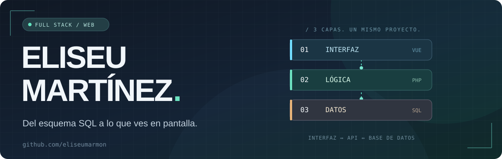
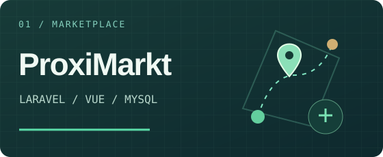
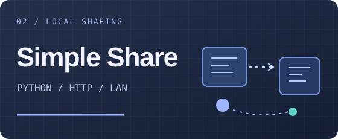

<p align="center">
  
</p>

<p align="center">
  <a href="mailto:eliseumarmon@gmail.com"></a>
  <a href="https://github.com/eliseumarmon?tab=repositories"></a>
</p>

### Hola, soy Eliseu.

Me gusta construir aplicaciones web desde dentro: **cómo se organiza la información, cómo se resuelve un problema en el backend y cómo termina llegando a la pantalla**.

Soy técnico superior en **Desarrollo de Aplicaciones Web** y estoy cursando **DAM**. He trabajado con **PHP, Symfony y Twig** en aplicaciones empresariales, desarrollando funcionalidades que se incorporaron a producción.

### Con qué trabajo

```text
INTERFAZ       HTML · CSS · JavaScript · Vue
BACKEND        PHP · Laravel · Symfony · Node.js · Express
DATOS          SQL · MySQL · diseño relacional
DÍA A DÍA      Git · Docker · Postman · APIs REST
```

También he trabajado con **WordPress, WooCommerce y Elementor**, y tengo fundamentos de Java.

### Algunos proyectos

<table>
<tr>
<td width="50%" valign="top">
  <a href="https://github.com/eliseumarmon/proxi-markt"></a>
  <p><strong><a href="https://github.com/eliseumarmon/proxi-markt">ProxiMarkt ↗</a></strong></p>
  <p>Marketplace de proximidad. Backend con Laravel, frontend con Vue, diseño de base de datos SQL y mapas con Leaflet y Nominatim.</p>
  <p><code>PHP</code> <code>Laravel</code> <code>Vue</code> <code>MySQL</code></p>
</td>
<td width="50%" valign="top">
  <a href="https://github.com/eliseumarmon/simple-share"></a>
  <p><strong><a href="https://github.com/eliseumarmon/simple-share">Simple Share ↗</a></strong></p>
  <p>Compartir archivos entre dispositivos de una red local desde el navegador, con acceso mediante códigos temporales y sin dependencias externas.</p>
  <p><code>Python</code> <code>HTTP</code> <code>LAN</code></p>
</td>
</tr>
</table>

### Del aula a producción

Durante mis prácticas en **Grup Apunts** diseñé un centro de notificaciones para *Oficina Virtual Empresa* y desarrollé un sistema de filtros guardados con un motor de **fechas relativas expresadas en JSON**. Me interesa especialmente ese tipo de retos: convertir necesidades reales en lógica reutilizable.

---

<p align="center">
  <sub>Una interfaz clara. Una lógica que tenga sentido. Datos bien pensados.</sub>
</p>
